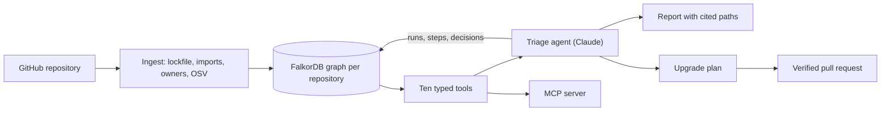

# Noderunner

**A dependency vulnerability triage agent that shows the graph path behind every decision — and checks its own fix
before it opens the pull request.**

You point Noderunner at a public npm repository. It loads the repository into a FalkorDB graph — files, imports,
installed packages, the full resolved dependency tree, known vulnerabilities, and code owners — then works out which
alerts production code can actually reach, the cheapest set of upgrades that clears them, and who should review
each change. It opens the pull request, re-checks the new lockfile against the graph, and remembers every waiver for
the next session.

Built by Team Noderunner (Shaukat Ali, Sakib Khan) for Graph Hacks by WeMakeDevs and FalkorDB, Track 1: Agents That
Act on Connected Data, Oct 15–18, 2026.

> **Status: design documented, implementation starting.** The commands below describe the intended interface and
> do not run yet. See the [delivery plan](nimbalyst-local/plans/noderunner.md) for progress.

---

## Why

- **Most alerts do not matter, and nobody can tell which.** A typical Node.js repository shows dozens to hundreds
  of alerts, most in packages production code never loads. Deciding means following file → dependency →
  transitive dependency → vulnerable version → fix → owner. That is a graph traversal, so the agent does it in the
  graph.
- **Every claim has a path.** Each tool call returns the nodes and edges it touched. The report cites a step for
  every sentence, and clicking a citation lights up that path on the graph.
- **The agent acts, and checks its work.** It opens a real pull request whose description lists the path behind
  each closed alert, after regenerating the lockfile in a sandbox and confirming in a scratch graph that the targeted
  alerts are gone and no new reachable ones appeared.
- **Memory that survives and goes stale visibly.** Waivers carry over to the next session, and are flagged — never
  silently dropped — when they expire, when the finding becomes reachable, or when the advisory changes.
- **Deterministic where it counts.** Tiers and the upgrade plan are computed in code, so the same commit gives the
  same answer. The model chooses tools and explains; it never decides a tier.
- **One set of tools, any client.** The same ten tools serve the built-in agent and any MCP client, such as Claude
  Code or Cursor.

---

## How it works



| Tier | Meaning | Default handling |
| --- | --- | --- |
| `import-reachable` | A production file loads a package whose installed tree reaches the vulnerable install | Fix |
| `installed` | In the production tree, but not reached from production code | Fix if cheap, otherwise report |
| `dev-only` | Every affected install is a dev install | Report, low priority |

"Reachable" means loaded by production code, at import level — not proven exploitable. The
[architecture](documents/public/architecture.md) explains the whole design.

---

## Quickstart (planned)

```bash
cp .env.example .env          # set ANTHROPIC_API_KEY, GITHUB_TOKEN, WORKER_TOKEN
docker compose up             # FalkorDB on 6379 with the Browser on 3000, the worker, and the web app
open http://localhost:3001    # paste a GitHub URL, or pick a pre-loaded demo repository
```

Use the same tools from Claude Code:

```bash
claude mcp add noderunner -- pnpm --filter @noderunner/mcp start
```

Then ask "which of my alerts are actually reachable?".

---

## FalkorDB features used

| Feature | Where |
| --- | --- |
| One graph per tenant | Each repository is its own graph, bound by the server, so one repository never leaks into another's run |
| Multi-hop traversal with bounded shortest paths | The tier query, from a production file to the vulnerable install |
| Graph algorithms as agent tools | PageRank over `DEPENDS_ON` in `rank_packages` |
| Read-only queries | `read_only_cypher`, the model's escape hatch, cannot write |
| The graph as agent memory | Runs, steps, findings, plans, and decisions are nodes the next session reads |

---

## Documentation

| Document | What it covers |
| --- | --- |
| [AGENTS.md](AGENTS.md) | Mandatory rules for every contributor and coding agent; start here |
| [documents/public](documents/public) | The architecture, the component designs, and the engineering and review standards |
| [contracts](contracts) | The graph schema, the tools, the worker API, and the event stream both halves build against |
| [nimbalyst-local/plans/noderunner.md](nimbalyst-local/plans/noderunner.md) | Tasks, owners, the cut order, and every open decision |

---

## Development

```bash
pnpm install
pnpm check     # Biome lint and format check, tsc --noEmit across the workspace
pnpm test      # Vitest, with FalkorDB running in Docker
pnpm eval      # graph agent against the no-graph baseline on the labelled repositories
```

---

## Project layout

```
apps/
  web/          Next.js UI: funnel, run view, graph canvas, compare page
  worker/       Run API, job queue, agent loop, composition root
packages/
  core/         types, zod schemas, ports, events — the contract every package depends on
  graph/        FalkorDB client and every Cypher query
  ingest/       the six ingestion stages
  tools/        the ten typed tools and callTool
  planner/      upgrade candidates and the weighted set cover
  executor/     lockfile regeneration, verification, the pull request
  mcp/          the MCP server over the tools
eval/           labels, baseline tools, runner, results
fixtures/       small lockfiles and the mini repository used by tests
docker/         the lockfile sandbox image
contracts/      the agreements between the two halves of the team
documents/      architecture, component designs, standards
```

---

## Prior art

Reachability filtering and automated upgrade pull requests both exist — `npm audit`, Dependabot, Renovate, Socket,
Snyk, Endor Labs, Semgrep Supply Chain, OWASP dep-scan, and the DepsRAG research system each cover part of the
problem, several at deeper (function-level) analysis than ours. Noderunner's contribution is the combination: a graph
path behind every claim, memory that persists and goes stale visibly, a fix verified before it is proposed, and the
same tools for any MCP client, open source on FalkorDB. See
[architecture.md](documents/public/architecture.md#14-prior-art).

## License

To be decided before submission; see `LICENSE` when added.
