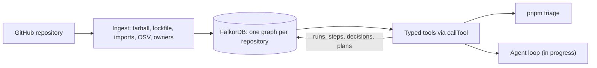
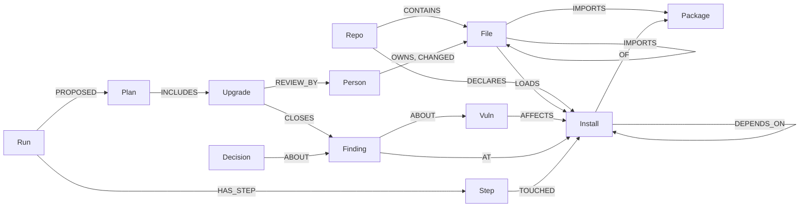

# Noderunner

**Most dependency alerts are in code your app never runs. Noderunner loads a repository into a FalkorDB graph,
follows the path from your production code to each vulnerable package, and plans the cheapest upgrades that fix
the ones that matter. Every claim comes with the graph path behind it.**

Built by Team Noderunner (Shaukat Ali, Sakib Khan) for Graph Hacks by WeMakeDevs and FalkorDB, Track 1: Agents That
Act on Connected Data, Oct 15–18, 2026.

```text
$ pnpm triage nestjs/nest

ALERTS
  56 open: 2 critical, 25 high, 24 moderate, 5 low
  10 import-reachable, 0 installed only, 46 dev-only

WHY THE 10 REACHABLE ONES MATTER
  GHSA-58qx-3vcg-4xpx  ws  (moderate)
    packages/platform-socket.io/adapters/io-adapter.ts → socket.io → socket.io-adapter → ws
    comes in through socket.io (4.8.4), socket.io-client (4.8.4)
  ...

PLAN  3 upgrades, cost 6, closes 10 of 10
  1. refresh brace-expansion 1.1.13 → 1.1.21  patch, closes 7
       review: @kamilmysliwiec, 10 recent commits
  2. refresh socket.io-parser 4.2.6 → 4.2.7  patch, closes 1
  3. override (workaround) ws 8.18.3 → 8.21.0  minor, closes 2
```

---

## Status

| Works today, tested on real repositories | In progress |
| --- | --- |
| Ingestion of any public npm repository: files, imports, the resolved dependency tree, OSV advisories, CODEOWNERS and git history | The model-driven agent loop and its cited report (`apps/worker`) |
| Eight graph tools behind one `callTool` that records every call as a Step: `list_alerts`, `reachability`, `introduced_by`, `plan_upgrades`, `owners_for`, `record_decision`, `recall_decisions`, `read_only_cypher` | The run view with the graph canvas (`apps/web`) |
| The upgrade planner: refresh, bump, and override, chosen by weighted set cover | The MCP server (`packages/mcp`) |
| Memory: decisions that persist across runs and are flagged when they go stale | Opening and verifying the pull request (`packages/executor`) |
| `pnpm triage`: the whole triage from the command line, no model needed | `rank_packages` (PageRank), the evaluation, hosting |
| The worker API and web shell: ingest a repository and see its funnel and alerts | |

---

## Why a graph

Deciding whether an alert matters means following a chain: production file → package it imports → the copy npm
installed → its dependencies → the vulnerable version → the fix → the people who own that code. That is a graph
traversal, so Noderunner does it in the graph, with one query, instead of guessing.

- **Most alerts don't matter, and the graph shows which do.** On `nestjs/nest`, 46 of 56 alerts are only in the dev
  tree, and the other 10 each come with the exact chain from a production file.
- **Every claim has a path.** Each tool call returns the nodes and edges it touched, and is stored as a `Step` linked
  to them with `TOUCHED`, so a report can cite the step and replay the path.
- **The plan is computed, not guessed.** Tiers and upgrades come from code, so the same commit gives the same answer.
  The model chooses which tools to call and explains; it never decides a tier or a fix.
- **Memory that goes stale visibly.** A waiver carries over to the next run, and is flagged, never silently kept,
  when it expires, when its finding becomes reachable, when the advisory changes, or when a worse vulnerability
  appears on the same install.

| Tier | Meaning |
| --- | --- |
| `import-reachable` | A production file loads a package whose installed tree reaches the vulnerable install |
| `installed` | In the production tree, but no production file loads it |
| `dev-only` | Every affected copy is a dev install |

"Reachable" means loaded by production code, at import level. It is not proof that the vulnerable function is called.

---

## Results

**On `nestjs/nest` @ `c215fd9`** (2,149 source files, 1,638 installs):

- **The same advisories as `npm audit`, at the right versions.** Both find the same 56 advisories, none missing on
  either side. Where they differ, npm audit lists every copy of a vulnerable package name, including copies already at
  the fixed version (root `micromatch` 4.0.8 is the fix for GHSA-952p); the graph links only the versions OSV lists as
  affected.
- **10 import-reachable, each with its chain.** We checked chains by hand against the lockfile and the source: for
  example, `io-adapter.ts` imports `socket.io` on line 14, and `socket.io` → `socket.io-adapter` → `ws` 8.18.3 is how
  the vulnerable `ws` gets loaded. Nest's lockfile marks some of these packages `dev`, though production code loads
  them; the graph catches that.
- **3 upgrades close all 10, at cost 6**, each checked against OSV's fix versions and the lockfile's ranges.
- **A waiver goes stale on contact.** Waiving the `ws` finding is flagged at once as "worse vulnerability on same
  install", because the same copy has a more severe advisory.
- **Timings:** ingestion 12.9–14.7 s (fetch 3.4, lockfile 0.15, imports 2.5, advisories 5.9, people 2.8, prune 0.05);
  the tier query 0.6 s; planning 1.1 s cold and 28 ms with the registry cache warm; `pnpm triage` 16 s end to end.

**On the test repository** (`fixtures/mini-repo`): `express` 4.17.1 pulls `body-parser`, which pins `qs` 6.7.0, so no
lockfile refresh of `qs` can fix it. The planner sees that `npm update express` to 4.22.3 pulls a `body-parser` that
pins a fixed `qs`, so **one refresh at cost 1 closes both reachable findings**.

---

## How it works



Ingestion runs six stages: read the commit's tarball in memory (nothing is cloned or executed), resolve the
lockfile the way Node does, parse imports with Babel, look up every installed version in OSV, read CODEOWNERS and
history, then prune what the commit no longer has.

### The graph



The left half is the supply chain, re-stamped on every ingest. The right half is the agent's memory: runs, steps,
findings, plans, and decisions are never deleted by ingestion, so the next session reads them with the same Cypher.
The full schema is [contracts/graph/schema.md](contracts/graph/schema.md).

---

## FalkorDB features used

| Feature | Where |
| --- | --- |
| One graph per tenant | Each repository is its own graph, named by the server and never by a caller |
| Multi-hop shortest paths | `tier.reachable`: `shortestPath((entry)-[:DEPENDS_ON*0..15]->(bad))` from every production-loaded install to every affected one, in one query |
| Read-only queries | `read_only_cypher`, the model's free-form escape hatch, runs through `GRAPH.RO_QUERY`, so it cannot write |
| The graph as agent memory | Steps link to the nodes they touched; decisions supersede each other; plans close findings |
| Batched writes | Ingestion writes with `UNWIND $rows` in chunks of 500 and `MERGE`, so a re-run at the same commit changes nothing |

### What we learned about FalkorDB

Found in our first spike and while building; each is handled in `packages/graph`:

- **Reads time out after 1 second by default** in the Docker image. Every call now sends its own `TIMEOUT`.
- **`shortestPath` works only as a projection**, in `WITH` or `RETURN`, not in `MATCH`; a minimum length of 0 is
  allowed, which handles a file that loads the vulnerable package directly.
- **A parameter named `cypher` breaks the Node client**, which sends parameters as a `CYPHER name=value` prefix.
- **Reading a graph that does not exist creates it**, so the catalog checks the graph list first.
- **`CREATE INDEX` is not idempotent**, so migration reads `db.indexes()` first.
- **With no `error` listener, a dropped connection crashes the process**, so `connect` requires one.
- **Writes ignore `TIMEOUT`**, so batches stay small and check the abort signal between chunks.

---

## Quickstart

Needs Node 22, pnpm, and Docker. No API keys.

```bash
pnpm install
docker run -d -p 6379:6379 -p 3000:3000 falkordb/falkordb   # FalkorDB, with its Browser on port 3000
FALKORDB_URL=redis://localhost:6379 pnpm triage nestjs/nest
```

Any public npm repository with a `package-lock.json` (version 2 or 3) works. Set `GITHUB_TOKEN` to raise GitHub's rate
limit. Open the FalkorDB Browser at http://localhost:3000 and select the `repo:nestjs/nest` graph to explore it.

The worker and web shell (`apps/worker`, `apps/web`) also ingest a repository and show its funnel and alerts; they
need the variables in [.env.example](.env.example).

---

## Development

```bash
pnpm check     # Biome lint and format, tsc --noEmit across the workspace
pnpm test      # Vitest; integration tests need FalkorDB and FALKORDB_URL
```

409 tests, most against a real FalkorDB. GitHub, OSV, and npm are replaced by recorded responses in `fixtures/`.

| Document | What it covers |
| --- | --- |
| [AGENTS.md](AGENTS.md) | The rules every contributor and coding agent follows |
| [documents/public](documents/public) | The architecture, each component's design, and the standards |
| [contracts](contracts) | The graph schema, the tools, the worker API, and the events |
| [documents/public/plan.md](documents/public/plan.md) | Tasks, owners, and every decision |

```text
apps/
  cli/          pnpm triage
  web/          Next.js UI
  worker/       Run API, job queue, composition root
packages/
  core/         types, zod schemas, ports: the contract every package depends on
  graph/        FalkorDB client and every Cypher query
  ingest/       the six ingestion stages and their adapters
  tools/        the typed tools and callTool
  planner/      upgrade candidates, the set cover, the npm registry adapter
  executor/     the pull request (in progress)
  mcp/          the MCP server (in progress)
fixtures/       the mini repository, lockfiles, and recorded OSV and npm responses
```

---

## Prior art

Reachability filtering and upgrade pull requests both exist: `npm audit`, Dependabot, Renovate, Socket, Snyk, Endor
Labs, Semgrep Supply Chain, OWASP dep-scan, and the DepsRAG research system each cover part of the problem, several
with deeper, function-level analysis than ours. Noderunner's contribution is the combination: a graph path behind
every claim, a plan computed from the graph rather than guessed by a model, memory that persists and goes stale
visibly, all open source on FalkorDB. See [architecture.md](documents/public/architecture.md#14-prior-art).

## License

[MIT](LICENSE)
