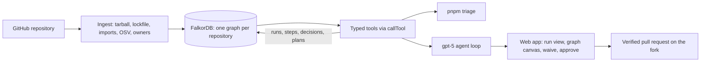
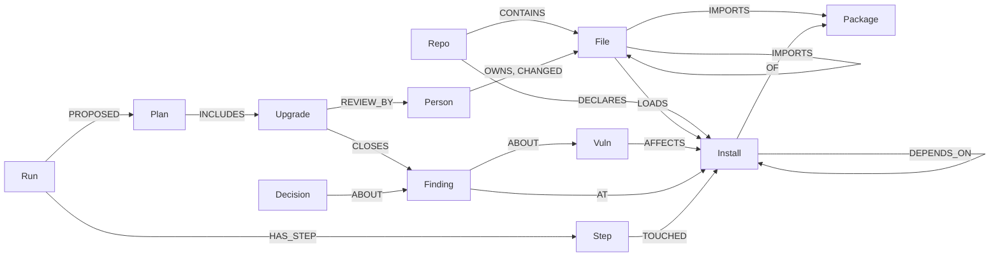

# Noderunner

**Most dependency alerts are in code your app never runs. Noderunner loads a repository into a FalkorDB graph,
follows the path from your production code to each vulnerable package, and plans the cheapest upgrades that fix
the ones that matter. Every claim comes with the graph path behind it.**

Built by Team Noderunner (Shaukat Ali, Sakib Khan) for Graph Hacks by WeMakeDevs and FalkorDB, Track 1: Agents That
Act on Connected Data, Oct 15–18, 2026.

**Interactive walkthrough:** <https://sakibalig.github.io/noderunner/>, a click-through of the whole flow on a real
run of `nestjs/nest` (source: [docs/index.html](docs/index.html), no backend).

```text
$ pnpm triage nestjs/nest

ALERTS
  56 open: 2 critical, 25 high, 24 moderate, 5 low
  10 import-reachable, 0 installed only, 46 dev-only

WHY THE 10 REACHABLE ONES MATTER
  GHSA-58qx-3vcg-4xpx  ws  (moderate)
    packages/platform-socket.io/adapters/io-adapter.ts → socket.io → socket.io-adapter → ws
    comes in through socket.io (4.8.4), socket.io-client (4.8.4)
  ...

PLAN  3 upgrades, cost 6, closes 10 of 10
  1. refresh brace-expansion 1.1.13 → 1.1.21  patch, closes 7
       review: @kamilmysliwiec, 10 recent commits
  2. refresh socket.io-parser 4.2.6 → 4.2.7  patch, closes 1
  3. override (workaround) ws 8.18.3 → 8.21.0  minor, closes 2
```

---

## Status

Everything below runs locally and was tested on `nestjs/nest`.

| Part | What it does |
| --- | --- |
| Ingestion | Any public npm repository: files, imports, the resolved dependency tree, OSV advisories, CODEOWNERS and git history |
| Tools | `list_alerts`, `reachability`, `introduced_by`, `plan_upgrades`, `owners_for`, `record_decision`, `recall_decisions`, `read_only_cypher`, `open_pull_request`, each call stored as a `Step` |
| Planner | Refresh, bump, and override, chosen by weighted set cover |
| Agent | A gpt-5 triage agent that picks its own tools and writes a report where every sentence cites the step behind it; the report is checked against the tool results before it is shown |
| Web app | Ingest a repository, see its funnel and alerts, open a finding's path and waive it, watch a run stream with the graph lighting up per citation, approve the plan, and open the pull request |
| Pull request | Edits `package.json`, regenerates the lockfile with npm (no scripts, no repository code), re-ingests and re-tiers it, refuses a change that makes a new alert reachable, then pushes to the fork |
| Memory | Waivers carry over to the next run and are flagged, and reopened, when they go stale |
| Evaluation | `pnpm eval`: the graph agent against a files-only baseline, scored against hand-checked labels |

Not built: the MCP server and the replay compare page.

---

## Why a graph

Deciding whether an alert matters means following a chain: production file → package it imports → the copy npm
installed → its dependencies → the vulnerable version → the fix → the people who own that code. That is a graph
traversal, so Noderunner does it in the graph, with one query, instead of guessing.

- **Most alerts don't matter, and the graph shows which do.** On `nestjs/nest`, 46 of 56 alerts are only in the dev
  tree, and the other 10 each come with the exact chain from a production file.
- **Every claim has a path.** Each tool call returns the nodes and edges it touched, and is stored as a `Step` linked
  to them with `TOUCHED`, so a report can cite the step and replay the path.
- **The plan is computed, not guessed.** Tiers and upgrades come from code, so the same commit gives the same answer.
  The model chooses which tools to call and explains; it never decides a tier or a fix.
- **Memory that goes stale visibly.** A waiver carries over to the next run, and is flagged, never silently kept,
  when it expires, when its finding becomes reachable, when the advisory changes, or when a worse vulnerability
  appears on the same install.

| Tier | Meaning |
| --- | --- |
| `import-reachable` | A production file loads a package whose installed tree reaches the vulnerable install |
| `installed` | In the production tree, but no production file loads it |
| `dev-only` | Every affected copy is a dev install |

"Reachable" means loaded by production code, at import level. It is not proof that the vulnerable function is called.

---

## Results

### Graph agent against a files-only baseline

From [eval/results.md](eval/results.md): `nestjs/nest` @ `c215fd9`, gpt-5, three runs each through the same agent
loop, the same 15-call cap, and the same report format. The baseline gets the alert list (without the graph's tiers)
and searches the source files, every `package.json`, and the lockfile.

| Agent | Precision | Recall | Tool calls | Time |
| --- | --- | --- | --- | --- |
| Graph agent | 100% | 83% (3 of 3 runs) | 9–11 | ~51 s |
| Baseline, files only | 100% (2 of 3 runs) | 25% (0–25%) | 15, capped every run | ~85 s |

The baseline finds packages that production code imports directly. It misses the seven `brace-expansion` alerts,
which reach production only through `@fastify/static` → `glob` → `minimatch`: a dependency walk, not a text search.
The graph agent's misses are honest too: an independent check, written outside Noderunner, found two `protobufjs`
alerts loaded through `createRequire(import.meta.url)('@grpc/grpc-js')`, which our import parser does not resolve.
The labels, their corrections, and the limits are in [eval/results.md](eval/results.md).

### Triage of `nestjs/nest`


**On `nestjs/nest` @ `c215fd9`** (2,149 source files, 1,638 installs):

- **The same advisories as `npm audit`, at the right versions.** Both find the same 56 advisories, none missing on
  either side. Where they differ, npm audit lists every copy of a vulnerable package name, including copies already at
  the fixed version (root `micromatch` 4.0.8 is the fix for GHSA-952p); the graph links only the versions OSV lists as
  affected.
- **10 import-reachable, each with its chain.** We checked chains by hand against the lockfile and the source: for
  example, `io-adapter.ts` imports `socket.io` on line 14, and `socket.io` → `socket.io-adapter` → `ws` 8.18.3 is how
  the vulnerable `ws` gets loaded. Nest's lockfile marks some of these packages `dev`, though production code loads
  them; the graph catches that.
- **3 upgrades close all 10, at cost 6**, each checked against OSV's fix versions and the lockfile's ranges.
- **A waiver goes stale on contact.** Waiving the `ws` finding is flagged at once as "worse vulnerability on same
  install", because the same copy has a more severe advisory.
- **Timings:** ingestion 12.9–14.7 s (fetch 3.4, lockfile 0.15, imports 2.5, advisories 5.9, people 2.8, prune 0.05);
  the tier query 0.6 s; planning 1.1 s cold and 28 ms with the registry cache warm; `pnpm triage` 16 s end to end.

**On the test repository** (`fixtures/mini-repo`): `express` 4.17.1 pulls `body-parser`, which pins `qs` 6.7.0, so no
lockfile refresh of `qs` can fix it. The planner sees that `npm update express` to 4.22.3 pulls a `body-parser` that
pins a fixed `qs`, so **one refresh at cost 1 closes both reachable findings**.

---

## How it works



Ingestion runs six stages: read the commit's tarball in memory (nothing is cloned or executed), resolve the
lockfile the way Node does, parse imports with Babel, look up every installed version in OSV, read CODEOWNERS and
history, then prune what the commit no longer has.

### The graph



The left half is the supply chain, re-stamped on every ingest. The right half is the agent's memory: runs, steps,
findings, plans, and decisions are never deleted by ingestion, so the next session reads them with the same Cypher.

### Graph data model

One FalkorDB graph per repository, named `repo:<owner>/<name>`; a pull request is first verified in a throwaway
`verify:<runId>` graph. The full schema, with every property and index, is
[contracts/graph/schema.md](contracts/graph/schema.md).

**Supply chain** (re-stamped with `snapshot_sha` on every ingest)

| Node | Key | Main properties |
| --- | --- | --- |
| `Repo` | `url` | `owner`, `name`, `default_branch`, `snapshot_sha`, `ingested_at` |
| `File` | `path` | `kind` (`prod`, `test`, `script`, `config`), `is_entry` |
| `Package` | `name` | — |
| `Install` | `lock_path` | `name`, `version`, `dev`, `optional`: one node per lockfile entry, so nested copies are separate |
| `Vuln` | `id` | `severity`, `severity_rank`, `aliases`, `ranges`, `fixed`, `modified` |
| `Person` | `handle` | `name`, `kind` |

| Relationship | From → to | Meaning |
| --- | --- | --- |
| `CONTAINS` | `Repo` → `File` | The file exists at the commit |
| `DECLARES` | `Repo` → `Install` | A direct dependency, with its `range` and `dev` |
| `IMPORTS` | `File` → `File` / `Package` | A resolved relative import, or a bare import |
| `LOADS` | `File` → `Install` | The installed copy Node would load for that import |
| `DEPENDS_ON` | `Install` → `Install` | Resolved from the lockfile the way Node resolves, with `range` and `kind` |
| `OF` | `Install` → `Package` | The install is a copy of the package |
| `AFFECTS` | `Vuln` → `Install` | The installed version is inside an affected range |
| `OWNS`, `CHANGED` | `Person` → `File` | CODEOWNERS, and commits in the last 200 |

**Agent memory and evidence** (never deleted by ingestion)

| Node | Key | Main properties |
| --- | --- | --- |
| `Finding` | `key` (`<vulnId>\|<package>`) | `severity`, `tier` (`import-reachable`, `installed`, `dev-only`), `status` (`open`, `planned`, `fixed`, `waived`) |
| `Run` | `id` | `agent`, `model`, `status`, `report`, `result`, `tokens_in`, `tokens_out` |
| `Step` | `id` | `seq`, `tool`, `input`, `ok`, `summary`, `cypher`, `ms` |
| `Plan` | `id` | `total_cost`, `uncovered`, `approved`, `approved_by` |
| `Upgrade` | `id` | `kind` (`refresh`, `bump`, `override`), `package`, `from`, `to`, `cost` |
| `Decision` | `id` | `kind` (`waive`, `accept`, `reject`), `reason`, `expires_at`, `tier_at_decision`, `stale_reason` |
| `PullRequest` | `url` | `number`, `branch`, `targeted`, `closed`, `new_findings` |

| Relationship | From → to | Meaning |
| --- | --- | --- |
| `ABOUT`, `AT` | `Finding` → `Vuln`, `Install` | The finding's advisory, and the copies it affects |
| `HAS_STEP`, `TOUCHED` | `Run` → `Step` → any | Every tool call, and every node it read: the evidence behind a citation |
| `FOUND` | `Run` → `Finding` | The run listed the finding |
| `PROPOSED`, `INCLUDES`, `CLOSES` | `Run` → `Plan` → `Upgrade` → `Finding` | The plan and what each upgrade closes |
| `REVIEW_BY` | `Upgrade` → `Person` | A suggested reviewer, with `why` |
| `ABOUT`, `MADE_BY`, `SUPERSEDES` | `Decision` → `Finding`, `Person`, `Decision` | A human decision, who made it, and what it replaced |
| `SHIPPED_AS` | `Plan` → `PullRequest` | The plan was opened as this pull request |

### The Cypher it depends on

Every query is a named, parameterised constant under [packages/graph/src/cypher](packages/graph/src/cypher); no
value is ever concatenated into a query, and every variable-length pattern is bounded. These are the ones the
product stands on.

**Reachability, the tier of every alert** (`tier.reachable`, [tools/tier.ts](packages/graph/src/cypher/tools/tier.ts)).
For each finding, the shortest `DEPENDS_ON` chain from any install a production file loads to an affected install.
`*0..15` covers a file that loads the vulnerable package itself; FalkorDB only accepts `shortestPath` as a
projection, in `WITH` or `RETURN`.

```cypher
MATCH (x:Finding)-[:AT]->(bad:Install)
WHERE size($keys) = 0 OR x.key IN $keys
MATCH (f:File {kind: "prod"})-[l:LOADS]->(entry:Install)
WITH x, bad, entry, f, l ORDER BY f.path
WITH x, bad, entry, collect({path: f.path, id: id(f), edge: id(l)})[0..3] AS files
WITH x, files, entry, shortestPath((entry)-[:DEPENDS_ON*0..15]->(bad)) AS p
WHERE p IS NOT NULL
WITH x, files, entry.name AS via, entry.lock_path AS start, length(p) AS hops,
     [n IN nodes(p) | n.lock_path] AS chain, [n IN nodes(p) | id(n)] AS nodeIds,
     [r IN relationships(p) | id(r)] AS edgeIds
ORDER BY hops ASC, start ASC
WITH x, head(collect({files: files, via: via, hops: hops, chain: chain, nodeIds: nodeIds, edgeIds: edgeIds})) AS best
RETURN x.key AS key, id(x) AS findingId, best.files AS files, best.via AS via, best.hops AS hops,
       best.chain AS chain, best.nodeIds AS nodeIds, best.edgeIds AS edgeIds
ORDER BY key LIMIT 5000
```

Findings with no path are `dev-only` when every affected install is dev, else `installed` (`tier.rest`).

**Who brought it in** (`chain.introduced`, [tools/chain.ts](packages/graph/src/cypher/tools/chain.ts)): the direct
dependencies whose tree reaches an affected install.

```cypher
MATCH (:Finding {key: $key})-[:AT]->(bad:Install)
MATCH (repo:Repo)-[d:DECLARES]->(top:Install)
WITH repo, d, top, bad, shortestPath((top)-[:DEPENDS_ON*0..15]->(bad)) AS p
WHERE p IS NOT NULL
RETURN top.name AS package, d.range AS range, d.dev AS dev, bad.lock_path AS target, length(p) AS hops,
       [n IN nodes(p) | n.lock_path] AS chain
ORDER BY hops, package, target LIMIT 50
```

**Upgrade candidates for the planner** (`plan.chains`, [tools/plan.ts](packages/graph/src/cypher/tools/plan.ts)):
every route of at most two hops from a direct dependency down to a vulnerable install, which the planner turns into
refresh, bump, and override candidates and solves as a weighted set cover.

```cypher
MATCH (x:Finding)-[:AT]->(bad:Install)
WHERE x.tier IN $tiers AND x.status IN ["open", "planned"]
MATCH p = (:Repo)-[d:DECLARES]->(top:Install)-[:DEPENDS_ON*0..2]->(bad)
RETURN x.key AS key, bad.lock_path AS lockPath, top.version AS version, d.range AS range,
       [n IN nodes(p) WHERE n:Install | n.name] AS path
ORDER BY key, lockPath, size(path) LIMIT 20000
```

**Reviewers** (`owners.files`, [tools/owners.ts](packages/graph/src/cypher/tools/owners.ts)): the production files
whose path reaches a finding an upgrade closes, with their owners and recent authors.

```cypher
MATCH (:Plan {id: $planId})-[:INCLUDES]->(u:Upgrade)-[:CLOSES]->(:Finding)-[:AT]->(bad:Install)
MATCH (f:File {kind: "prod"})-[:LOADS]->(entry:Install)
WITH DISTINCT u, f, entry, bad
WITH u, f, shortestPath((entry)-[:DEPENDS_ON*0..15]->(bad)) AS p
WHERE p IS NOT NULL
WITH DISTINCT u, f
OPTIONAL MATCH (o:Person)-[:OWNS]->(f)
WITH u, f, collect(DISTINCT o.handle) AS owners
OPTIONAL MATCH (c:Person)-[ch:CHANGED]->(f) WHERE ch.last_at >= $since
RETURN u.id AS upgrade, f.path AS file, owners, collect({handle: c.handle, commits: ch.commits}) AS changed
ORDER BY upgrade, file LIMIT 2000
```

**Batched, idempotent ingestion** (`lockfile.depends`, [ingest/lockfile.ts](packages/graph/src/cypher/ingest/lockfile.ts)),
sent in chunks of 500 rows:

```cypher
UNWIND $rows AS r
MATCH (a:Install {lock_path: r.from}), (b:Install {lock_path: r.to})
MERGE (a)-[e:DEPENDS_ON]->(b)
SET e.range = r.range, e.kind = r.kind, e.snapshot_sha = $sha
```

The same `tier.reachable` query runs again on the `verify:<runId>` graph before a pull request opens, and `ship.keys`
compares the two graphs by finding key. The model's free-form `read_only_cypher` tool runs through
`GRAPH.RO_QUERY`, so FalkorDB itself refuses any write.

---

## FalkorDB features used

| Feature | Where |
| --- | --- |
| One graph per tenant | Each repository is its own graph, named by the server and never by a caller |
| Multi-hop shortest paths | `tier.reachable`: `shortestPath((entry)-[:DEPENDS_ON*0..15]->(bad))` from every production-loaded install to every affected one, in one query |
| Read-only queries | `read_only_cypher`, the model's free-form escape hatch, runs through `GRAPH.RO_QUERY`, so it cannot write |
| The graph as agent memory | Steps link to the nodes they touched; decisions supersede each other; plans close findings |
| Batched writes | Ingestion writes with `UNWIND $rows` in chunks of 500 and `MERGE`, so a re-run at the same commit changes nothing |

### What we learned about FalkorDB

Found in our first spike and while building; each is handled in `packages/graph`:

- **Reads time out after 1 second by default** in the Docker image. Every call now sends its own `TIMEOUT`.
- **`shortestPath` works only as a projection**, in `WITH` or `RETURN`, not in `MATCH`; a minimum length of 0 is
  allowed, which handles a file that loads the vulnerable package directly.
- **A parameter named `cypher` breaks the Node client**, which sends parameters as a `CYPHER name=value` prefix.
- **Reading a graph that does not exist creates it**, so the catalog checks the graph list first.
- **`CREATE INDEX` is not idempotent**, so migration reads `db.indexes()` first.
- **With no `error` listener, a dropped connection crashes the process**, so `connect` requires one.
- **Writes ignore `TIMEOUT`**, so batches stay small and check the abort signal between chunks.

---

## Setup

Hosting is local: everything runs on one machine. Needs Node 22 or later, pnpm 10, and Docker.

### 1. The triage from the command line (no API key)

```bash
git clone https://github.com/sakibalig/noderunner && cd noderunner
pnpm install
docker compose up -d falkordb          # FalkorDB on 6379, its Browser on http://localhost:3000
FALKORDB_URL=redis://localhost:6379 pnpm triage nestjs/nest
```

Any public npm repository with a `package-lock.json` (version 2 or 3) works. Open the FalkorDB Browser at
http://localhost:3000 and select the `repo:nestjs/nest` graph to explore it.

### 2. The full app: agent, web UI, and pull requests

```bash
cp .env.example .env
```

| Variable | Value |
| --- | --- |
| `OPENAI_API_KEY` | An OpenAI key with access to `gpt-5` |
| `GITHUB_TOKEN` | A fine-grained GitHub token: public read; for pull requests, Contents and Pull requests write on your fork only |
| `PR_TARGET_OWNER` | The GitHub owner of your fork of the repository you triage; pull requests go nowhere else |
| `WORKER_TOKEN` | Any random string of 32 or more characters (`openssl rand -hex 32`) |

The other defaults in `.env.example` fit a local run. Then:

```bash
docker compose up -d falkordb
set -a; . ./.env; set +a
pnpm --filter @noderunner/worker start      # terminal 1: the worker API on :8787
pnpm --filter @noderunner/web dev           # terminal 2: the web app on http://localhost:3001
curl localhost:8787/healthz                 # {"ok":true,"falkordb":true,"model":true}
```

In the web app: paste a repository URL and ingest it, open the repository, press **Run triage agent**, click a
citation to light its path in the graph, open an alert to see its path or waive it, approve the plan, and press
**Open pull request** (needs the fork). Troubleshooting and the demo pre-load are in the
[runbook](documents/public/runbook/deploy.md).

### 3. The evaluation

```bash
pnpm eval run --runs 3      # graph agent against a files-only baseline; writes eval/results.md
```

---

## Development

```bash
pnpm check     # Biome lint and format, tsc --noEmit across the workspace
pnpm test      # Vitest; integration tests need FalkorDB and FALKORDB_URL
```

About 590 tests, most against a real FalkorDB. GitHub, OSV, and npm are replaced by recorded responses in `fixtures/`.

| Document | What it covers |
| --- | --- |
| [AGENTS.md](AGENTS.md) | The rules every contributor and coding agent follows |
| [documents/public](documents/public) | The architecture, each component's design, and the standards |
| [contracts](contracts) | The graph schema, the tools, the worker API, and the events |
| [documents/public/plan.md](documents/public/plan.md) | Tasks, owners, and every decision |

```text
apps/
  cli/          pnpm triage
  web/          Next.js UI
  worker/       Run API, job queue, composition root
packages/
  core/         types, zod schemas, ports: the contract every package depends on
  graph/        FalkorDB client and every Cypher query
  ingest/       the six ingestion stages and their adapters
  tools/        the typed tools and callTool
  planner/      upgrade candidates, the set cover, the npm registry adapter
  executor/     the pull request: package.json edit, npm sandbox, verification, GitHub push
  mcp/          the MCP server (not built)
eval/           labels, the runner, and results.md
fixtures/       the mini repository, lockfiles, and recorded OSV and npm responses
```

---

## Prior art

Reachability filtering and upgrade pull requests both exist: `npm audit`, Dependabot, Renovate, Socket, Snyk, Endor
Labs, Semgrep Supply Chain, OWASP dep-scan, and the DepsRAG research system each cover part of the problem, several
with deeper, function-level analysis than ours. Noderunner's contribution is the combination: a graph path behind
every claim, a plan computed from the graph rather than guessed by a model, memory that persists and goes stale
visibly, all open source on FalkorDB. See [architecture.md](documents/public/architecture.md#14-prior-art).

## License

[MIT](LICENSE)
