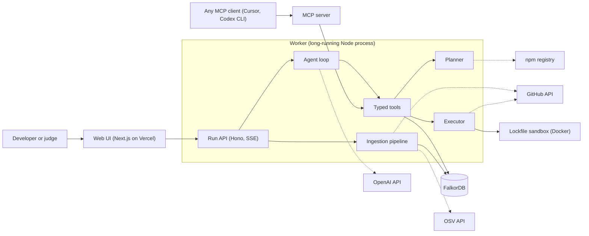
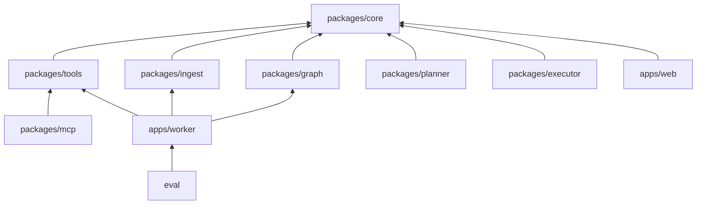
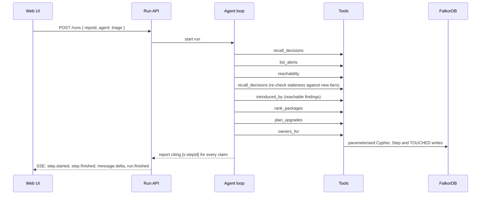

# Architecture — High-Level Design

Noderunner is a dependency vulnerability triage agent built on FalkorDB for the Graph Hacks hackathon, Track 1:
Agents That Act on Connected Data. You point it at a public npm repository; it loads the repository into a graph,
works out which vulnerability alerts production code can actually reach, finds the cheapest set of upgrades that
clears them, names who should review each change, opens the pull request, and checks its own fix — showing the
graph path behind every claim. This document is the high-level design. Package detail lives in
[components](components), shared shapes in [contracts](../../contracts), and the rules in
[standards/engineering.md](standards/engineering.md).

---

## 1. Purpose

A typical Node.js repository shows dozens to hundreds of dependency alerts. Most sit in packages production code
never loads, or only in dev tooling. Teams either ignore the list or spend days on upgrades that change nothing.
Answering "which of these matter, and what is the cheapest fix" means following a chain — source file, direct
dependency, transitive dependency, vulnerable version, fixed version, the upgrade that pulls the fix in, the people
who own that code — and that chain is a graph traversal.

| Goal | How the design delivers it |
| --- | --- |
| Fast ingestion | A public repository is in the graph in under a minute, from one tarball and batched writes |
| Honest triage | Every alert is classed `import-reachable`, `installed`, or `dev-only`, by query, not by the model |
| Cheapest fix | A deterministic planner picks the smallest covering set of upgrades, with breaking risk marked |
| A real action | The agent opens a pull request whose description carries the graph path for every alert it closes |
| Checked work | The new lockfile is re-ingested and re-tiered before the pull request is opened |
| Memory | Waivers and decisions persist across sessions and are flagged, never dropped, when they go stale |
| Traceability | Every claim in the report cites a step, and the UI highlights that step's nodes and edges |

**Non-goals.** Ecosystems other than npm with `package-lock.json` version 2 or 3; function-level or call-graph
reachability (the tier is import-level, and the product says so); proving exploitability ("reachable" means "loaded
by production code"); auto-merging; private repositories beyond one demo token; and running any code from the
scanned repository.

---

## 2. System context

Three design choices shape everything else:

- **One tool layer, two front doors.** The ten tools are one TypeScript package. The agent loop calls them in
  process, and the MCP server exposes the same functions to any MCP client — the Track 1 focus "tool selection
  through MCP" without a second implementation.
- **A long-running worker, not serverless.** Ingestion and a run each take one to two minutes. Vercel only renders
  pages and proxies to the worker.
- **The graph holds the agent's reasoning too.** Runs, steps, findings, plans, and decisions are nodes in the same
  repository graph. The UI replays a run by reading the graph, and the next session reads past decisions with the
  same kind of query it uses for dependencies.

---

## 3. Layering

Hexagonal and inward. `packages/core` holds the domain types, policies, ports, and events and depends on nothing
but `zod` and `semver`; every other package depends on it, never the reverse.

| Layer | Package | Responsibility |
| --- | --- | --- |
| **Core** | `packages/core` | Domain types, zod schemas, ids, the `ToolResult` envelope, `RunEvent`, ports, environment schema |
| **Graph** | `packages/graph` | The FalkorDB adapter: connect, query, read-only query, batched writes, migrate, every Cypher constant |
| **Application** | `packages/ingest` | The six ingestion stages, from tarball to pruned snapshot |
|  | `packages/tools` | The ten tools, the registry, and `callTool`, which writes a Step for every call |
|  | `packages/planner` | Candidate upgrades and the greedy weighted set cover, over a registry port |
|  | `packages/executor` | `package.json` edits, sandboxed lockfile regeneration, verification, the pull request |
| **Surface** | `apps/worker` | The Run API, the job queue, the agent loop, and the composition root |
|  | `packages/mcp` | The MCP server over the same tools, stdio or Streamable HTTP |
|  | `apps/web` | The repository page with the funnel, the run view, the compare page, the waive drawer |
| **Evaluation** | `eval` | Hand labels, the baseline agent's tools, and the runner that scores both agents |

---

## 4. Core concepts

| Concept | What it is |
| --- | --- |
| **Install** | One entry in the lockfile's `packages` map, keyed by its install path. One package can have several installs at different versions |
| **Finding** | One vulnerability in one package, keyed `vulnId|package`, linked to every install it affects. The unit the agent triages, plans, and waives |
| **Tier** | `import-reachable`: a production file loads an install that reaches the affected install. `installed`: in the production tree but not reached from production code. `dev-only`: every affected install is a dev install |
| **Evidence** | The nodes, edges, and queries one tool call touched. Stored as `TOUCHED` edges from the Step, streamed to the UI, never sent to the model |
| **Plan** | A set of upgrades, each `refresh`, `bump`, or `override`, with the findings it closes and its cost |
| **Decision** | A human waiver, acceptance, or rejection of a finding, with a reason, an author, and an optional expiry |
| **Run** | One agent session: its steps, its report, its plan, and the approval flag the pull request needs |

The full schema is in [contracts/graph/schema.md](../../contracts/graph/schema.md).

---

## 5. Flow: ingestion

| # | Stage | What happens | Writes |
| --- | --- | --- | --- |
| 1 | Fetch | Resolve the default branch to a commit, download one tarball, keep `package.json`, `package-lock.json`, CODEOWNERS, and source files in memory. No clone, no execution | `Repo` |
| 2 | Lockfile | Walk the `packages` map into installs, resolve each dependency the way Node does, mark dev installs from npm's own flags | `Package`, `Install`, `OF`, `DECLARES`, `DEPENDS_ON` |
| 3 | Imports | Parse every source file with Babel, resolve relative imports to files and bare imports to packages and to the install Node would load, class each file | `File`, `IMPORTS`, `LOADS` |
| 4 | Advisories | Look up each name and version in the shared cache, send misses to OSV in batches, store ranges and fixed versions, create findings | `Vuln`, `AFFECTS`, `IN_PACKAGE`, `Finding`, `AT` |
| 5 | People | Match CODEOWNERS rules to files; count commits per author per file from a blob-less partial clone | `Person`, `OWNS`, `CHANGED` |
| 6 | Prune | Delete supply-chain data from older commits, mark findings with no remaining install `fixed`, stamp the repository | `Repo`, `Finding.status` |

Each stage emits `ingest.progress`. Stage 5 is a "should": if git or the network fails it is skipped with a warning.
Detail: [components/ingest.md](components/ingest.md).

---

## 6. Flow: a triage run

The agent chooses its own tools, but the system prompt describes this default plan and the demo follows it.

The report opens with a funnel — all alerts, in the production tree, import-reachable, still open after the plan —
then the plan as a table, the reviewers, stale waivers, and what was not covered. `validateReport` checks that every
citation names a step of this run and that each funnel number matches its tool result; one correction round is
allowed, after which the run finishes flagged `unverified` rather than hiding the report. Detail:
[components/agent.md](components/agent.md).

---

## 7. Flow: the action and its verification

1. A human approves the plan in the UI, which sets `Plan.approved`, and presses ship, which starts a shipment job.
2. The executor loads the plan, edits `package.json` for bumps and overrides, and regenerates the lockfile in a
   throwaway container with `npm install --package-lock-only --ignore-scripts`. Only the two package files are
   mounted, so no repository code is present.
3. It ingests the repository's source files with the edited `package.json` and the regenerated lockfile into a
   fresh `verify:<runId>` graph, and re-runs the tier query there.
4. If any new finding is import-reachable it stops and reports instead of opening anything.
5. Otherwise it pushes a branch through the Git Data API, opens the pull request on the team's fork, and records
   `(:Plan)-[:SHIPPED_AS]->(:PullRequest)`. The description lists, for each closed alert, the path from a production
   file to the vulnerable install, and the verification result — for example "closes 6 of 6 targeted alerts,
   introduces 0 new ones".

Detail: [components/executor.md](components/executor.md).

---

## 8. Memory and handoff

**What is remembered.** Episodic: every run and step, with what it touched. Semantic: findings and their status over
time. Decisions: waivers, accepted and rejected upgrades, who made them, why, and until when.

**When a decision goes stale.** Its expiry has passed; the finding's tier rose to `import-reachable` since the
decision; the advisory was modified after the decision; or a more severe vulnerability now affects the same install.
Stale decisions are flagged and the agent must raise them.

**Two agents, one graph** (a "should"). The triage agent writes findings and a plan. A fixer agent, started later in
a fresh session with no conversation history, finds the latest unshipped plan in the graph, checks that no later
decision conflicts with it, waits for approval, and opens the pull request. The only handoff is graph state — the
Track 2 idea of shared state between agents, shown without a framework. If the fixer is cut, the UI's ship button
calls the same tool directly.

---

## 9. Contracts

| Contract | Fixes |
| --- | --- |
| [graph/schema.md](../../contracts/graph/schema.md) | Graph names, labels, keys, relationships, indexes, re-ingest behaviour |
| [mcp/tools.md](../../contracts/mcp/tools.md) | The ten tools, the `ToolResult` envelope, and which caller gets which tools |
| [api/worker.md](../../contracts/api/worker.md) | The Run API routes, authentication, and limits |
| [api/events.md](../../contracts/api/events.md) | The SSE stream and the `RunEvent` union |
| [api/errors.json](../../contracts/api/errors.json) | Error codes, statuses, and retryability |

The `packages/core` types are the executable form of these documents and are agreed first, because the graph half
and the agent and UI half both build against them with mock data until the real implementations land.

---

## 10. Dependencies

| Dependency | Purpose | Owning package |
| --- | --- | --- |
| `zod` | Every boundary schema; JSON Schema for the model and MCP | `core` |
| `falkordb` | The official Node client | `graph` |
| `tar-stream` | Streaming the repository tarball | `ingest` |
| `@babel/parser` | Parsing imports in JS and TS source | `ingest` |
| `semver` | Range checks, `maxSatisfying`, semver jumps | `core`, `planner` |
| `ignore` | gitignore-style CODEOWNERS matching | `ingest` |
| `openai` | The agent loop's model calls through the Responses API, model `gpt-5`, `gpt-5-mini` as fallback | `apps/worker` |
| `@modelcontextprotocol/sdk` | The MCP server | `mcp` |
| `hono`, `@hono/node-server`, `p-queue` | The Run API, SSE, and the job queue | `apps/worker` |
| `pino` | Structured logging | `apps/worker`, `mcp` |
| `next`, `react`, `cytoscape`, `cytoscape-dagre` | The web UI and the graph canvas | `apps/web` |
| `detect-indent` | Preserving `package.json` formatting | `executor` |
| `ulid` | Run, step, plan, and decision ids, behind the `Ids` port | `apps/worker` |
| `vitest`, `@biomejs/biome`, `typescript`, `tsx` | Tests, lint and format, types, running TypeScript directly | root |

---

## 11. Deployment

| Piece | Local | Hosted |
| --- | --- | --- |
| Web UI | `next dev` | Vercel, deploying from `main` only |
| Worker | `tsx watch` | One 2 GB container on Fly.io or Railway, so runs are not cut off by function time limits |
| FalkorDB | `docker run -p 6379:6379 -p 3000:3000 falkordb/falkordb`, with the Browser on port 3000 | FalkorDB Cloud |
| Sandbox | A local container on the bridge network, with resource limits and no repository code mounted | Open: the worker hosts offer no Docker daemon (D14) |
| Secrets | `.env` at the root | Each host's secret store |

`docker compose up` brings up FalkorDB, the worker, and the web app. The three demo repositories and one finished run
for each are pre-loaded on the hosted build so judges see results without waiting. Detail:
[components/deploy.md](components/deploy.md).

---

## 12. Cross-cutting requirements

| Concern | Target | How |
| --- | --- | --- |
| Scale | About 3,000 installs and 5,000 source files per repository | Well under 100,000 nodes; no sharding |
| Ingestion | Under 60 s for a medium repository, under 10 s on an advisory cache hit | One tarball, batched `UNWIND` writes, the shared advisory cache |
| Triage run | Under 90 s and at most 15 tool calls | Tools that handle every finding at once; a hard step cap |
| Query latency | Each tool under 500 ms | Indexes, bounded path lengths |
| Determinism | The same repository and commit give the same tiers and plan | Algorithms in code; the model orchestrates and explains |
| Cost | A few cents to low tens of cents per run | Short tool outputs; a stable instructions-and-tools prefix that OpenAI's automatic prompt caching reuses |
| Isolation | One repository's data never appears in another's run | One graph per repository, bound by the server |

Security rules — no execution of scanned code, read-only free-form queries, tenant binding, prompt-injection
handling, the token's scope, and no secrets in the graph or logs — are in
[standards/engineering.md](standards/engineering.md#security).

---

## 13. Evaluation

The brief says the graph has to shape what the agent does, so the design proves it with a small, honest
comparison. Three public repositories, pinned to older commits with known alerts, are labelled by hand. A baseline
agent with the same model and goal but only `list_alerts`, a file search, and a file reader is scored against the
graph agent on precision and recall of the "must fix" list, upgrades proposed, alerts closed after verification,
tool calls, time, and tokens. The results go in the README, the blog post, and the video, reported as they are even
where the baseline comes close. Detail: [components/eval.md](components/eval.md).

---

## 14. Prior art

Reachability and automated upgrade pull requests both exist: `npm audit`, Dependabot, and Renovate list alerts and
open upgrades without reachability; Socket, Snyk, Endor Labs, and Semgrep Supply Chain filter by reachability,
some at function level, as closed products; OWASP dep-scan separates declared from reachable dependencies as an
open-source scanner; DepsRAG builds a dependency knowledge graph and reports on it. Noderunner does not claim
reachability as new. What it combines is a graph path for every claim, decisions that persist and go stale
visibly, an agent that verifies its own fix before acting, two agents sharing one graph, and the same tools for any
MCP client — all open source on FalkorDB. The comparison it makes is against `npm audit` and Dependabot, which is
what most developers use.

---

## 15. Known gaps

- Reachability is import-level. A production file that imports a package but never calls the vulnerable function
  is still `import-reachable`.
- `tsconfig.json` path aliases are not resolved; imports through them are counted in warnings.
- Workspaces, pnpm, and Yarn lockfiles are unsupported.
- Replaying a run from before a re-ingest highlights fewer nodes, because pruned installs take their `TOUCHED`
  edges with them. Steps keep their summaries and queries.
- Ownership falls back to CODEOWNERS only when the history clone fails.
- The FalkorDB details marked `VERIFY` in the component designs — `shortestPath` placement, `algo.pageRank`, and the
  read-only query path — are from general knowledge until the spike confirms them.
- The sandbox's network egress is not restricted to the npm registry; `--ignore-scripts` and the absence of any
  repository code are what keep lockfile regeneration safe.
