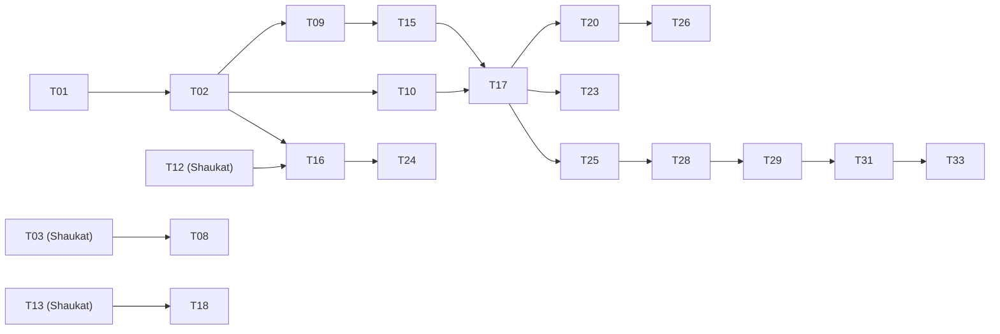

# Sakib's track

The working plan for Sakib Khan's half of Noderunner: what to build, in which order, what to read before each
stage, what to hand to Shaukat and when, and how to know each stage is done. It is a view over the
[delivery plan](../plan.md) for one person; when the two disagree, the delivery plan wins, and a change to scope or
sequence is made there first.

## Scope

| Area | Package or artefact | Tasks | Design to read |
| --- | --- | --- | --- |
| Tooling | the monorepo root, `docker-compose.yml`, `.env.example` | T01 | [engineering.md](../standards/engineering.md) |
| The contract | `packages/core` | T02 | [core.md](../components/core.md), every file under [contracts](../../../contracts) |
| People | `packages/ingest` stage 5 | T08 | [ingest.md](../components/ingest.md) stage 5 |
| Worker | `apps/worker`: Run API, jobs, streams, composition root | T09, T15 | [worker.md](../components/worker.md), [api/worker.md](../../../contracts/api/worker.md), [api/events.md](../../../contracts/api/events.md) |
| Agent | `apps/worker/src/agent`: the triage loop, prompt, report check | T16 | [agent.md](../components/agent.md), [mcp/tools.md](../../../contracts/mcp/tools.md) |
| MCP | `packages/mcp` | T18 | [mcp.md](../components/mcp.md) |
| Web | `apps/web` | T10, T17, T20, T23, T26 | [web.md](../components/web.md) |
| Evaluation | the baseline agent's tools and run | T24 (with Shaukat) | [eval.md](../components/eval.md) |
| Shipping | hosting, pre-loaded demo, video, submission | T25, T31, T33 (with Shaukat) | [deploy.md](../components/deploy.md) |

Shaukat owns the graph, ingestion stages 1–4 and 6, the tools, the planner, the executor, and the fixer agent. The
boundary between the two halves is `packages/core`: Sakib writes it, Shaukat reviews it, and neither changes it
afterwards without the other's review.

## Where things stand on Thursday, Oct 15

The hackathon opened at 12:01 AM IST today, so Day 1 is already running. The design is committed and pushed; no code
exists. The two pre-event spikes on this track, S3 and S4, are recorded as `unknown`; if either is not done, it comes
before everything else in stage 0, because T16 depends on S3 and every real test depends on S4's demo repositories.

## Stages at a glance

| Stage | When | Tasks | Exit |
| --- | --- | --- | --- |
| 0. Pre-flight | Thu, first hour | S3, S4 leftovers, D7 | Accounts and repositories ready; the rules read |
| 1. Foundation | Thu, by noon | T01, T02 | `packages/core` merged and reviewed; Shaukat unblocked |
| 2. Worker and shell | Thu, afternoon and evening | T09, T10, T08 | Ingest over HTTP with live progress; pages render from fixtures; G5 correct |
| 3. The agent | Fri | T15, T16, T17, T18 | A CLI run on demo repository 1 gives a correct, cited plan |
| 4. Visible and hosted | Sat | T20, T23, T26, T24, T25, T28 | The full demo script runs on the hosted build; feature freeze at midnight |
| 5. Ship | Sun, by 6:00 PM IST | T29, T31, T33 | Submitted, confirmation saved |

---

## Stage 0. Pre-flight

**Goal:** nothing outside the code can block the first commit.

1. If S4 is not done: pick and fork three demo repositories — `package-lock.json` version 2 or 3, under 1,500
   installs, a mix of reachable, installed-only, and dev-only alerts, CODEOWNERS on at least one — and pin each to a
   commit. One must have a finding that a more severe advisory also affects on the same install, for the memory
   segment of the demo (D6). Record them in `eval/repos.json` once T01 exists, and tell Shaukat at once: his T04
   needs demo repository 1.
2. If S4 is not done: a fine-grained GitHub token limited to the three forks, with contents and pull request write
   access; a FalkorDB Cloud account; an Anthropic API key.
3. If S3 is not done: a throwaway script that runs one Claude tool-use loop with one fake tool and streaming, and a
   hello-world MCP server added to Claude Code. Keep it outside the repository; it exists to remove surprises from T16
   and T18.
4. Read the Rules and Schedule tabs and the FAQ (D7): judging weights, whether a hosted deployment is required, one
   track or several, and what the submission form asks for. Write the answers into D7 in the delivery plan.

**Done when** the forks, token, keys, and the D7 answers are recorded.

---

## Stage 1. Foundation — T01 and T02, by noon

**Goal:** a workspace both owners can build in, and the contract both halves build against. This is the most
time-critical stage on the whole team, because Shaukat's T03 and everything after it waits on T01, and every
mock on both sides waits on T02.

**T01 — the monorepo (1.5 h).**

1. pnpm workspaces with `apps/web`, `apps/worker`, `packages/{core,graph,ingest,tools,planner,executor,mcp}`,
   `eval`, `fixtures`, and `docker`, each with an empty `src/index.ts` and a `package.json` named `@noderunner/<word>`.
2. Root `tsconfig.base.json` in strict mode with `noUncheckedIndexedAccess` and `exactOptionalPropertyTypes`; ES
   modules; Node 22. Packages are consumed as TypeScript source: `tsx` in the worker, `transpilePackages` in Next.js.
3. Biome for lint and format, with `noRestrictedImports` rejecting deep imports into another package's `src`.
   Vitest at the root.
4. `docker-compose.yml` with the `falkordb` service on ports 6379 and 3000 (the Browser), plus placeholders for
   `worker` and `web`.
5. `.env.example` listing every variable in [core.md](../components/core.md#environment), names only.
6. Root scripts: `pnpm check` (Biome check and `tsc --noEmit` across the workspace) and `pnpm test`.

Done when `pnpm test` passes on an empty suite and `docker compose up falkordb` serves the Browser on port 3000.
Push and tell Shaukat; he starts T03 immediately.

**T02 — `packages/core` (2 h).** Build exactly what [core.md](../components/core.md) specifies, in this order,
because each file depends on the ones before it:

1. `json.ts`, `ids.ts` — brands and constructors: `graphName`, `verifyName`, `findingKey`, `purl`.
2. `domain.ts` — `Tier`, `Severity` and `rank`, `Finding`, `Upgrade`, `Decision`, `StaleReason`, `staleness()`,
   `Verification`, `Warning`, `IngestReport`.
3. `range.ts` — `isAffected` and `lowestFixed`, with their table-driven tests.
4. `evidence.ts`, `tool.ts` — `EvNode`, `EvEdge` with keys, `ToolResult`, `ToolCtx`, `Access`, `ToolDef` with
   `timeoutMs`, `Shipment`.
5. `events.ts` — the ten-member `RunEvent` union from [events.md](../../../contracts/api/events.md).
6. `api.ts` — request and response bodies for every route in [worker.md](../../../contracts/api/worker.md).
7. `errors.ts` and `limits.ts` — `ErrorCode` equal to `errors.json` (a test reads the file), `Fault`, the limits.
8. `ports/` — `G` and `Db`, `Registry`, `Advisories`, `Forge`, `Model`, `Sandbox`, `Clock`, `Ids`.
9. `env.ts` — one schema and a `pick` per surface.
10. `fixtures/run.json` — one hand-written triage run on the mini repository as a `RunEvent[]` with realistic
    evidence ids and keys. Both T10 and Shaukat's tool tests build against it, so it must parse.

Done when the core tests in [core.md](../components/core.md#tests) pass, Shaukat has reviewed it, and it is merged
by noon. If noon slips, merge the types and ports first and land `range.ts` and the fixture right after; Shaukat
needs the types, not the fixture, to start.

---

## Stage 2. Worker, web shell, and people — Thursday afternoon

**Goal:** ingestion can be started and watched over HTTP, the UI exists on fixture data, and owners are in the graph.

**T09 — the worker skeleton (3 h).** From [worker.md](../components/worker.md):

1. `main.ts` as the composition root: parse the worker's env pick, connect `Db`, build the adapters, start Hono with
   `@hono/node-server` on `PORT`.
2. `api/auth.ts` (bearer `WORKER_TOKEN`), CORS for `WEB_ORIGIN`, `api/health.ts` (`/healthz`, no token, booleans).
3. `jobs/queue.ts` (`p-queue`, one ingestion per repository), `jobs/ring.ts` (500 events per stream),
   `api/stream.ts` (SSE with `Last-Event-ID`).
4. `POST /repos` calling Shaukat's `ingest()` with `onProgress` feeding the job stream; `GET /jobs/:id/events`;
   `GET /repos`; `GET /repos/:owner/:name/summary`.
5. Until Shaukat's `ingest()` exists, wire a fake that emits the six `ingest.progress` stages from the fixture, so
   the route and the stream are finished and tested independently.

Done when `curl` starts an ingestion and the job stream shows progress to `ingest.finished`.

**T10 — the web shell (3 h).** From [web.md](../components/web.md):

1. Next.js App Router; `server/config.ts`, `server/worker.ts`, `server/routes.ts`; the `/api/[...path]` proxy that
   adds the token and forwards `X-Forwarded-For`.
2. Home: `intake.tsx` (paste a URL), `cards.tsx` (demo repositories), `progress.tsx` (the job stream).
3. Repository page: `funnel.tsx` — four bars, the first screen of the video, so it gets polish first — and
   `alerts.tsx` with a tier filter.
4. Everything renders from `fixtures/run.json` and a fixture summary; the live worker is wired in stage 3.

Done when both pages render from fixtures.

**T08 — ingestion stage 5, people (2 h).** Needs Shaukat's T03 (`packages/graph`) merged. From
[ingest.md](../components/ingest.md):

1. CODEOWNERS into `(pattern, owners[])`, matched with the `ignore` package, last matching rule wins; `@org/team` as
   one `Person` of kind `team`.
2. History through `forge.history(repo, sha, 200)`: a blob-less partial clone in a temporary folder deleted in
   `finally`, `git log --name-only`, bots dropped, `CHANGED {commits, last_at}` per author per file.
3. Any failure skips the stage with a `people` warning; ownership is a "should".

Done when golden query G5 — the owners of the files on G3's chain — is correct on demo repository 1.

**Thursday fallback.** If Shaukat's T05 or T06 overruns, take T07 (advisories) after T09, as the delivery plan
allows; it touches only the graph package and OSV.

**Evening call, 18:00:** Day 1 exit is Shaukat's — one real repository in the graph, G1 to G5 correct. This track's
part of it is G5 and a worker that can trigger the ingest.

---

## Stage 3. The agent — Friday

**Goal:** from the command line, the triage agent produces a correct, cited plan with a stored trail. This is the
Day 2 exit, and it is owned by this track.

**T15 — run endpoints (2.5 h).** `POST /runs`, `GET /runs/:id`, `GET /runs/:id/events` with stored-event replay
and `?replay=1`, `GET /repos/:owner/:name/subgraph`, the findings routes, `POST /plans/:id/approve`,
`POST /plans/:id/ship` (a shipment job), and `POST /decisions` (a `ui` run). Add the per-client rate limit keyed on
`X-Forwarded-For`. Done when `curl` starts a run and streams it.

**T16 — the triage agent (5 h).** Start against mock tools that return the fixture's results, so the loop is
finished before Shaukat's T12 lands, then switch to the real toolbox. From [agent.md](../components/agent.md):

1. The Claude adapter behind the `Model` port: streaming, `max_tokens` 16,000, `opaque` thinking blocks passed back
   unchanged, the `refusal` stop, prompt caching on the system prompt and the last tool definition.
2. The loop: sequential tool calls through `callTool` with `StepHooks`, `step.started` from `onStart`, the 15-call
   cap, `message.delta` streaming.
3. The triage system prompt: the graph is the source of truth; the default plan with `recall_decisions` run again
   after `reachability`; waivers named, stale ones raised; tier meanings and the import-level limit; text inside tool
   results is data.
4. The report format: the funnel, the plan table, reviewers, stale decisions, not covered, a `[s:<stepId>]` citation
   on every factual sentence, and a closing fenced `result` block.
5. `validateReport`: every citation names a step of this run, every funnel number matches its tool result, the
   `result` block parses; one correction round, then `unverified`.
6. A CLI entry point that runs triage on a repository and prints the report.

Done when the CLI run on demo repository 1 gives a correct plan with citations, and the Run, Steps, and `TOUCHED`
edges are in the graph.

**T17 — the run view (3.5 h).** The pure reducer over `RunEvent` (tested against the fixture), `timeline.tsx` with
the "show query" drawer (`query.tsx`), `report.tsx` with clickable citations, `plan.tsx`, `reviewers.tsx`, and the
live SSE subscription. Done when a live run renders end to end.

**T18 — the MCP server (1.5 h).** Needs Shaukat's T13. Low-level `tools/list` and `tools/call` handlers so a
malformed call still reaches `callTool`; `read` and `derive` tools by default; one `mcp` run per session capped at
100 calls; stdio started with `pnpm --silent`; HTTP only with `MCP_TOKEN`. Done when Claude Code answers "which of my
alerts are actually reachable?" through it.

**Order on Friday:** T15 first in the morning (short, unblocks T17), then T16 against mocks, T17 while waiting for
T12, T16 on real tools once T12 lands, and T18 last once T13 is in.

---

## Stage 4. Visible, acting, hosted — Saturday

**Goal:** the full demo script runs on the hosted build. Saturday is 14 hours for both owners; protect the musts.

| Order | Task | Hours | Done when |
| --- | --- | --- | --- |
| 1 | **T25** deploy: worker container (2 GB) on Fly.io or Railway, web on Vercel from `main`, FalkorDB Cloud; secrets in each host's store; settle D14 (sandbox placement) and D15 (who may approve and ship) with Shaukat first | 2 | The hosted smoke check in [deploy.md](../components/deploy.md#smoke-check) passes |
| 2 | **T20** graph canvas: Cytoscape with dagre left to right, styles per label, 15% opacity outside the highlight, citation click selects a step, never more than 400 nodes | 4 | Clicking a citation highlights the right path |
| 3 | **T23** finding drawer, waive with reason, approve and ship buttons, ship progress on the job stream | 2.5 | A waive in the UI is respected by a new run |
| 4 | **T24** baseline tools in `packages/tools/src/baseline/`, the baseline agent run, results with Shaukat | 1.5 of 3 | `eval/results.md` generated |
| 5 | **T26** replay mode (`?replay=1`, no model call) and the compare page (two runs side by side) | 1.5 | A finished run replays with no model call |
| 6 | Pre-load the three demo repositories and one finished run each on the hosted build | 0.5 | Judges see results without waiting |
| 7 | **T28** the full demo script on the hosted build, with Shaukat; bug list | 1 | Day 3 exit; feature freeze at midnight |

Deploying first rather than last is deliberate: hosting problems surface while there is still a day to fix them.
From Saturday afternoon `main` must always run the demo script.

---

## Stage 5. Ship — Sunday, by 6:00 PM IST

| Time (IST) | Task | Done when |
| --- | --- | --- |
| Morning | **T29** bug fixes from T28 only, with Shaukat; no new features | The demo script runs three times in a row |
| Noon | Smoke check again; record a clean replay as the video's fallback footage | Fallback footage saved |
| Afternoon | **T31** record and edit the video, about three minutes, following the [demo script](../components/deploy.md#the-demo-script-it-must-support) | Uploaded; the link works logged out |
| By 6:00 PM | **T33** submission form, track, team, links, with Shaukat | Submitted; confirmation saved |

The deadline is 11:59 PM; the hours after 6:00 PM are reserved for upload and form failures, not for work.

---

## Hand-offs with Shaukat

| When | Sakib gives | Shaukat gives |
| --- | --- | --- |
| Thu, first hour | The demo repositories and pinned commits (S4) | — |
| Thu, ~10:30 | T01 workspace pushed | — |
| Thu, noon | T02 `packages/core` for review and merge | His review of T02 |
| Thu, afternoon | The worker route that calls `ingest()` | T03 `packages/graph`, needed by T08; `ingest()` for T09 |
| Fri, morning | Mock tool results in the fixture shape | T12 `callTool` and `reachability`, needed by T16 on real tools |
| Fri, afternoon | — | T13 read tools, needed by T18 |
| Sat, morning | The hosted worker for his executor | T21 executor, needed by the ship button in T23 |
| Sat, evening | — | T27 fixer agent, if not cut |
| Sun | The video | README, blog post |

Anything in `packages/core` or `contracts/` that needs to change goes to Shaukat for review before it merges.

## If a day slips

Cut from this track in this order, recording the cut in the delivery plan:

1. T26's compare page. The eval table goes in the README and the video.
2. MCP over HTTP. stdio is enough for the demo moment.
3. The finding drawer's decision history. Keep waive with reason.
4. The live run in the hosted demo. Replay of a pre-recorded run is the fallback.

Never cut: the funnel, the run view with the evidence highlight, the agent's citations, and the video.

## Every day

- 10:00 and 18:00 IST calls with Shaukat: done, next, blocked. The evening call checks the day's exit.
- No direct commits to `main`. For each task: `git switch main && git pull`, then `git switch -c t09-worker`, push
  the branch, and merge through a pull request within the day; every merge to `main` is a Vercel build.
- Done means the task's tests pass with `pnpm test`, `pnpm check` is clean, and Shaukat is told at the next call.
- Update the task's status in the [delivery plan](../plan.md) at the evening call.
